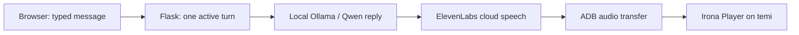

# A conversation that reaches the robot.

**Irona** connects a browser conversation to speech on a temi robot. The goal is a small, understandable conversational system whose context, audio destination and failure behavior are explicit.

Type in the browser; a local language model generates the reply; cloud text-to-speech creates the audio; a native Android player speaks it on temi.

<a name="verification"></a>

## Working today

The owner confirmed **three replies playing through temi's speaker**. The repository also records mocked checks for context, reset, stop, player heartbeat expiry and failure handling. Hardware confirmation and automated tests are documented separately in the [verification log](docs/verification.md).

Input is typed. Microphone input, vision, navigation and model-driven movement are not implemented. Audio uses a development ADB transport and a foreground Android player on a trusted LAN; it is not an unattended deployment.

<a name="architecture"></a>

## Follow one turn



The integration work is the turn pipeline, bounded in-memory conversation, explicit audio routing, native player and stop/error handling. Qwen, Ollama, ElevenLabs and temi are external components. Reply text leaves the machine for cloud speech; the full system is not offline. Model output is never executed as commands.

## Read the code

| Question | Start here |
| --- | --- |
| How are turns and browser controls handled? | [`irona/app.py`](irona/app.py) |
| How do generation, speech and cancellation connect? | [`irona/pipeline.py`](irona/pipeline.py) · [`irona/services.py`](irona/services.py) |
| How does audio reach temi? | [`irona/temi.py`](irona/temi.py) · [Android player](android/) |
| What happens when something fails? | [Tests](tests/) · [Verification evidence](docs/verification.md) |

<a name="setup-on-ubuntu"></a>

<a name="launch"></a>

<a name="troubleshooting"></a>

## Run the smallest check

Python 3.10 or newer; from the repository root:

```sh
python3 -m venv .venv
.venv/bin/python -m pip install -r requirements.lock
.venv/bin/python -m pip install --no-deps -e .
.venv/bin/python -m pytest -q
```

The automated tests mock paid services and robot transport. They require no live TTS call or robot. For a working conversation, follow the [setup and verification guide](docs/SETUP_AND_VERIFICATION.md), including Ollama, model, private environment settings and the explicit audio destination.

<a name="repository-and-next-steps"></a>

## Next milestone

Evaluate the conversation style and turn handling on the confirmed speaker path, then choose between push-to-talk input and replacing the development transport. Record a reproducible demonstration before expanding the robot's capabilities.

[Setup, operational controls and decisions](docs/SETUP_AND_VERIFICATION.md) · [Verification log](docs/verification.md)

No project license has been selected. Existing third-party attribution remains in place.
